# User Manual — Breakdown (DMBD)

Panduan memakai modul **Breakdown** di ARKA PCR: mencatat unit down, activity, work order SAP (opsional), close RFU, report board, dan dashboard Daily Monitoring.

| | |
| --- | --- |
| **Dokumen** | User Manual Breakdown / DMBD |
| **Tanggal** | 3 November 2026 |
| **Bahasa** | Bahasa Indonesia. Nama tombol dan kolom di layar tetap bahasa Inggris |
| **Untuk** | Plant / maintenance di site, planner, dan pembaca dashboard |

Tombol yang tidak muncul berarti akun Anda tidak punya izin. Minta administrator bila perlu izin `breakdown.read` / `.create` / `.update` / `.cancel` / `.delete`.

---

## Daftar Isi

1. [Ringkasan](#1-ringkasan)
2. [Cara membuka menu](#2-cara-membuka-menu)
3. [List Breakdown](#3-list-breakdown)
4. [Add / Edit](#4-add--edit)
5. [Detail, Activity, Close, Cancel, Delete](#5-detail-activity-close-cancel-delete)
6. [Import / Export history](#6-import--export-history)
7. [Report Summary Breakdown](#7-report-summary-breakdown)
8. [Dashboard DMBD](#8-dashboard-dmbd)
9. [PA Maintenance + Breakdown](#9-pa-maintenance--breakdown)
10. [Alur kerja singkat](#10-alur-kerja-singkat)

---

## 1. Ringkasan

Satu **Breakdown** = satu episode perbaikan unit (biasanya satu WO SAP). **Position** (BD / OP / SB / AJ) ada di **Activity**, bukan di header. **RFU** = unit sudah finish (`finished_at` terisi).

| Istilah | Artinya |
| --- | --- |
| **Register no** | Nomor BD, misalnya `BD-021C.2611-0001` (site + bulan BD date + seq). Diberikan sekali saat create |
| **BD date / Start** | Tanggal–jam mulai downtime (sama dengan jam di database, tanpa geser timezone) |
| **STATUS UNIT** | RFU jika sudah finish; jika masih open = posisi activity terakhir |
| **STATUS WO** | OPEN / CLOSE pada work order |
| **Activity** | Potongan kerja (kode B0, B3, … + posisi BD/OP/SB/AJ) |
| **AJ** | Additional job — boleh paralel dengan open BD di unit yang sama |
| **Cancel** | Batalkan episode terbuka: status menjadi **CANCEL** (record tetap ada). Activity SAP dinonaktifkan, WO SAP di-cancel bila terhubung. Tidak dihitung di dashboard / PA |

### Yang perlu diingat

- **Maksimal satu open BD-position per unit.** Episode tambahan harus AJ (atau OP/SB). Form add memberi peringatan dan default position AJ bila unit masih punya open BD.
- **Close** wajib: nomor WO terisi, semua activity punya end date/time, resolution diisi.
- **Cancel** hanya untuk BD yang masih open. Record **tidak dihapus** — status unit = CANCEL dan tidak memengaruhi dashboard / PA. BD yang sudah RFU tidak bisa di-cancel.
- **Delete** menghapus record permanen (izin terpisah). Bedakan dari Cancel.
- **Create WO SAP** bersifat opt-in di form. Tanpa centang, data hanya lokal (nomor WO boleh diketik manual).
- **Import history** hanya seed data lama — tidak membuat/close WO di SAP.

---

## 2. Cara membuka menu

1. Login ARKA PCR.
2. Menu **Breakdowns** → **List** / **Add**.
3. **Reports** → **Summary Breakdown** untuk board populasi unit.
4. **Dashboards** → **DMBD** untuk daily monitoring.

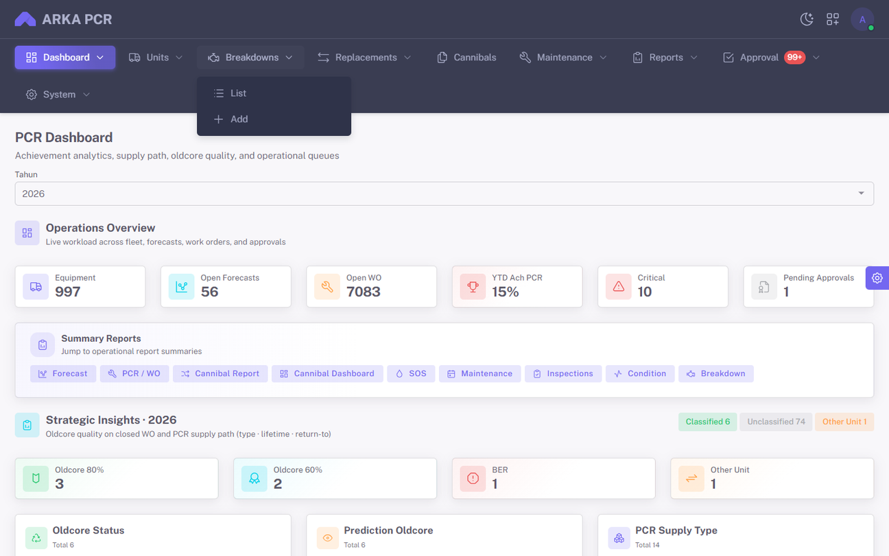

---

## 3. List Breakdown

Filter: Project, Unit, Open/closed, **Status unit** (RFU / BD / OP / SB / AJ / CANCEL), rentang BD date, finish date, Description.

Tombol di kanan baris filter: **Reset**, **Export**, **Import**, **Add**.

Kolom mengikuti laporan harian (Register No, Project, TYPE, UNIT, HM, WO, OPERATOR, STATUS WO, STATUS UNIT, BD CODE, DESCRIPTION, BD DATE, FINISH DATE, DOWN TIME, Component, REMARK, **Action**).

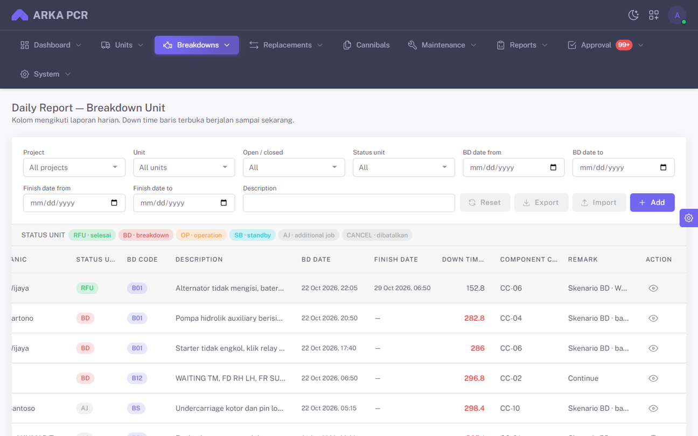

- Status unit **RFU** = sudah finish.
- Filter Status unit **RFU** menampilkan hanya yang sudah finish; **BD/OP/SB/AJ** hanya yang masih open dengan posisi itu.
- Kolom paling kanan **Action** berisi tombol **View**.

---

## 4. Add / Edit

Wizard **New breakdown**: **Breakdown** → **Activity** (hanya add) → **Create SAP WO** → **Review**. Edit tidak punya langkah Activity.

### Langkah 1 — Breakdown

Project, Unit, start date/time, hour meter, problem, last operator, dll. Model & serial dari ARKFleet (read-only). Register no = preview sampai disimpan.

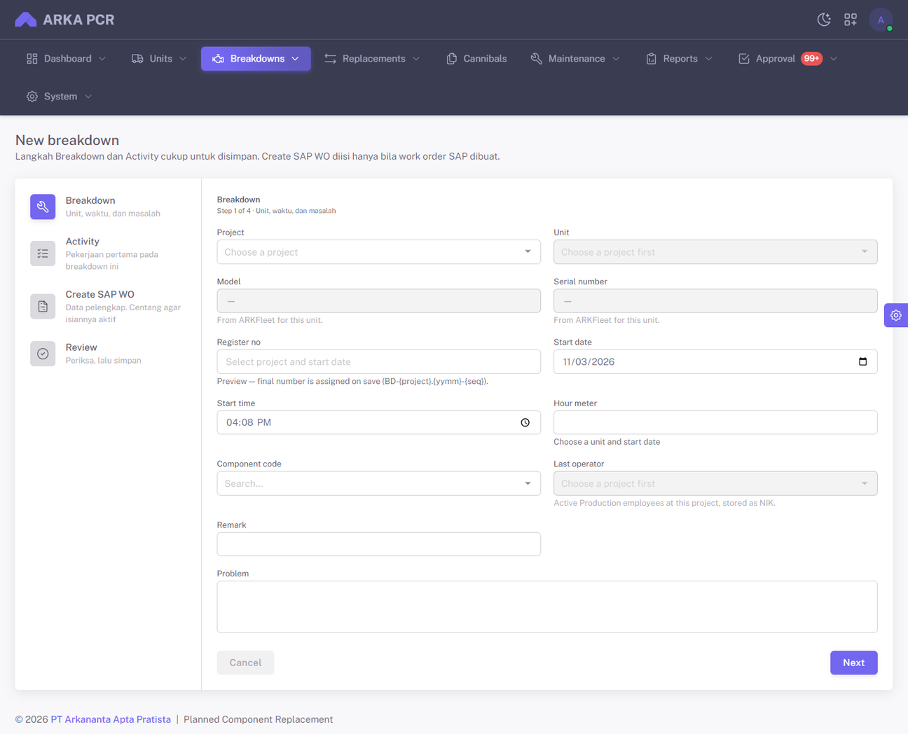

Contoh setelah Project / Unit / Problem diisi:

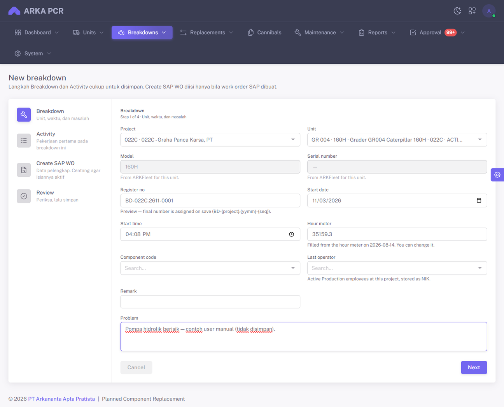

Hour meter diisi otomatis dari pembacaan HM terdekat pada/sebelum tanggal start, lalu boleh diubah.

### Langkah 2 — Activity

Activity code, position (BD/OP/SB/AJ), start/end, mechanic, details. Wajib untuk add.

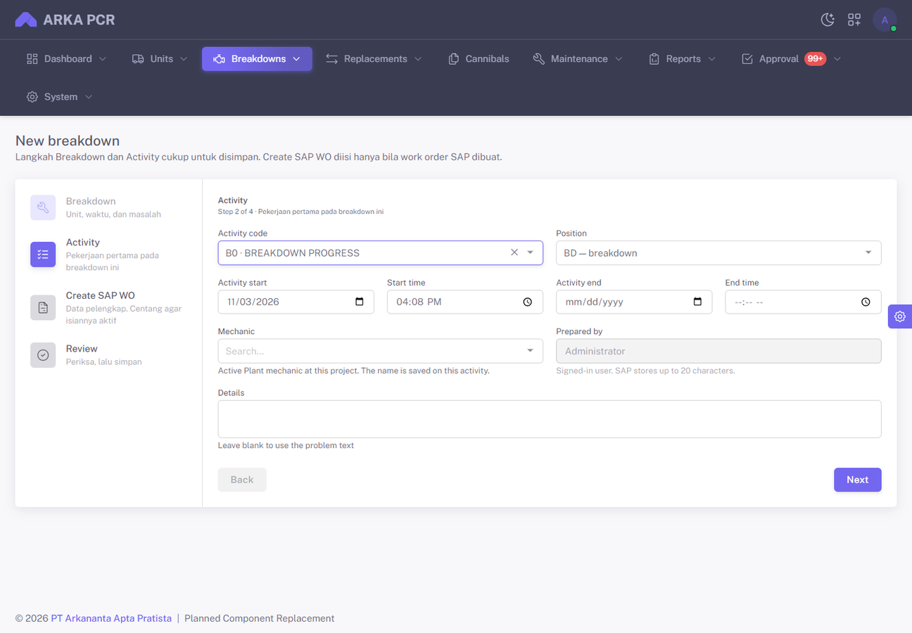

### Langkah 3 — Create SAP WO

Centang **Create WO SAP** agar field SAP aktif dan WO dibuat di Service Layer. Tanpa centang: field nonaktif; nomor WO boleh diketik manual (hanya lokal).

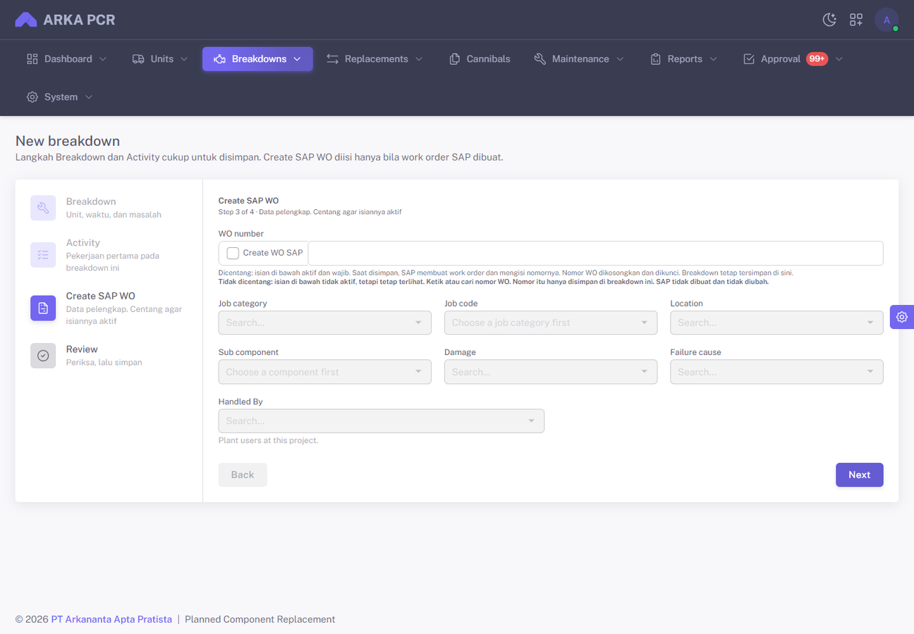

### Langkah 4 — Review

Ringkasan semua isian. Tombol **Save record** (atau **Save and create WO** bila Create WO dicentang).

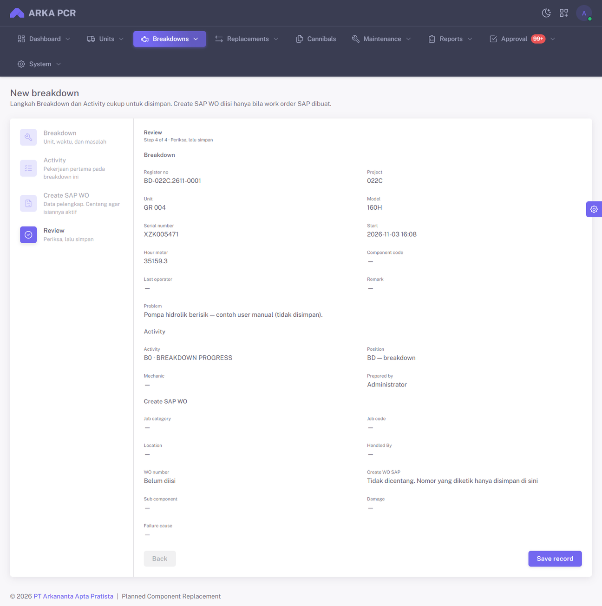

---

## 5. Detail, Activity, Close, Cancel, Delete

Halaman detail menampilkan status, HM, downtime, BD/finish date, kartu unit, description, dan timeline activity.

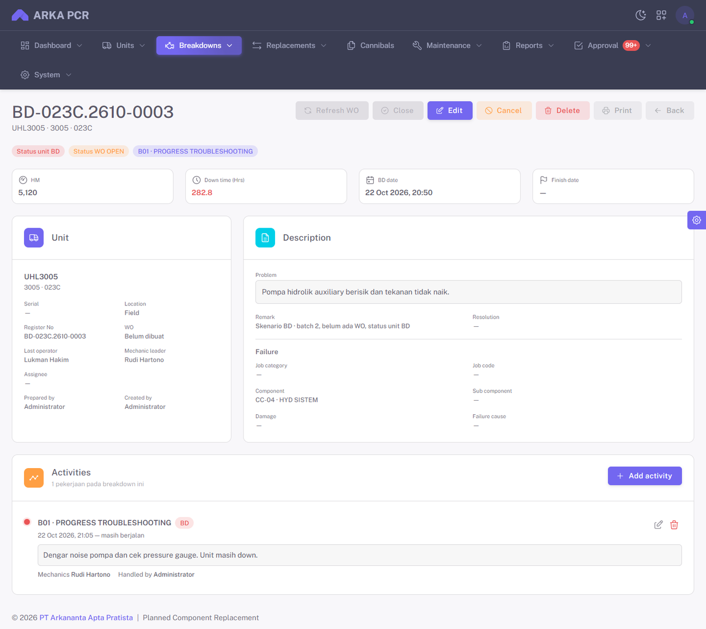

| Tombol | Syarat | Efek |
| --- | --- | --- |
| **Refresh WO** | Terhubung SAP | Tarik header + activity dari SAP |
| **Close** | Ada nomor WO; semua activity sudah end | Set finish + resolution (+ patch SAP bila linked) |
| **Edit** | Masih open | Ubah header termasuk start date/time |
| **Cancel** | Izin `breakdown.cancel`; masih open | Status **CANCEL** (record tetap, tidak dihitung dashboard/PA); activity SAP dinonaktifkan + WO SAP dibatalkan bila linked |
| **Delete** | Izin `breakdown.delete` | Hapus **permanen** BD + activity dari ARKA PCR. Jika masih open dan linked SAP, WO/activity SAP dibatalkan dulu. Tidak bisa di-undo |
| **Print** | Baca BD | Buka layout cetak (A4) di tab baru: header unit/WO, description, failure, tabel activity |
| **Add / Edit / Delete activity** | Masih open | Kelola activity; sync SAP bila linked |

**Cancel ≠ Delete.** Cancel = tandai dibatalkan (audit tetap ada). Delete = hilangkan record.

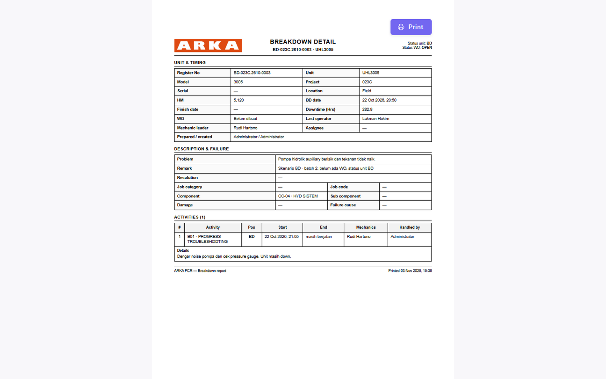

Halaman print: `/breakdowns/print/[id]` — tombol **Print** / Save as PDF di browser; toolbar tidak ikut tercetak.

---

## 6. Import / Export history

Di list: **Export** mengunduh Excel mirip kolom seed; **Import** membuka panduan lalu upload file.

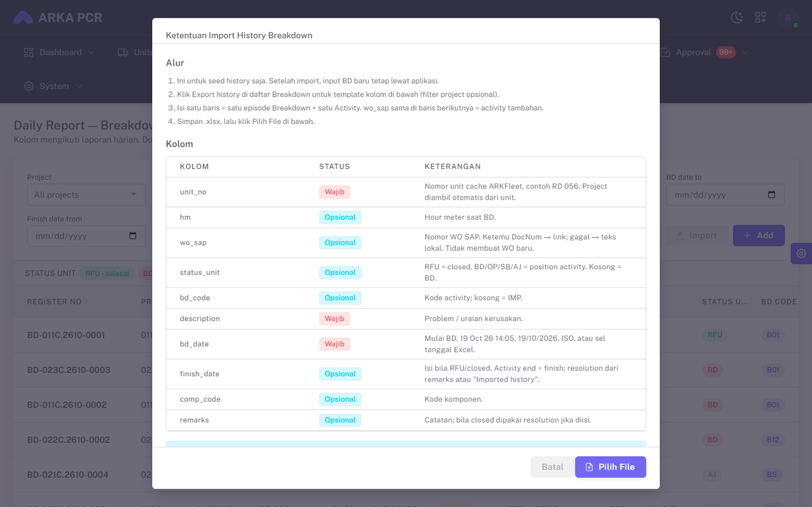

Kolom inti seed: `unit_no`, `hm`, `wo_sap`, `status_unit`, `bd_code`, `description`, `bd_date`, `finish_date`, `comp_code`, `remarks`.

- 1 baris = 1 Breakdown + 1 Activity. WO sama → baris berikutnya = activity tambahan.  
- Error per baris bisa diunduh sebagai Excel.  
- Import **tidak** create/close WO di SAP.

---

## 7. Report Summary Breakdown

Board populasi unit **ACTIVE** per site, dikelompokkan plant group. Pilih **Site** terlebih dahulu.

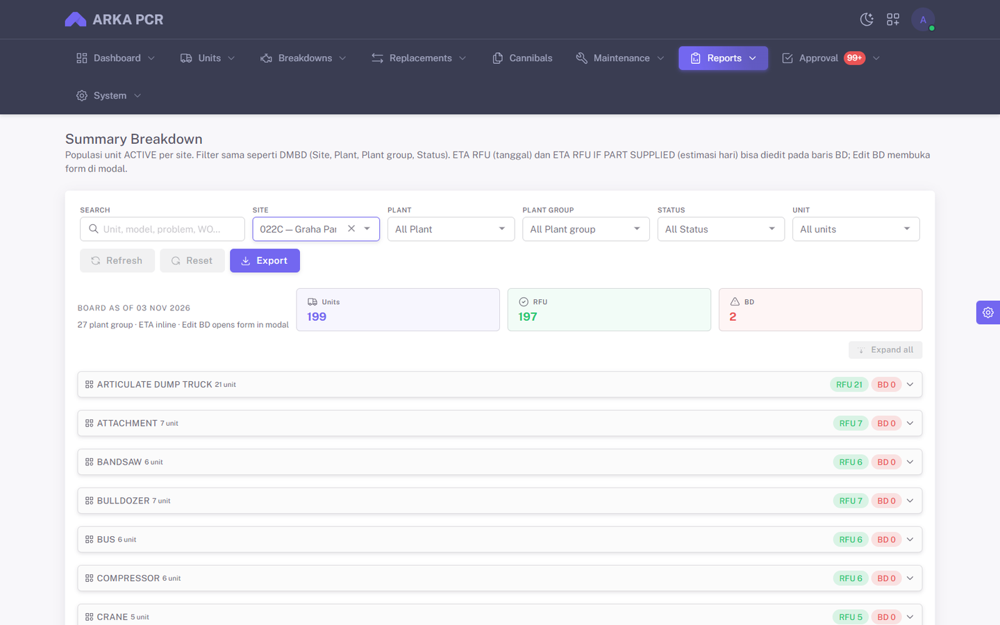

- Unit RFU tetap tampil (tanpa rincian BD).  
- Kolom BD hanya dari open episode **BD-position** (open AJ tidak membuat board non-RFU).  
- **ETA RFU** (tanggal) dan **ETA RFU IF PART SUPPLIED** (hari) bisa diedit inline.  
- **Edit BD** membuka form di modal.  
- **Export Excel** dari halaman report.

---

## 8. Dashboard DMBD

Filter Period + MTD/YTD, site, plant, category. Kartu status: breakdown / waiting part / under repair / ready. KPI MTTR, MTBF, PA dari data breakdown. Auto refresh default 5 menit.

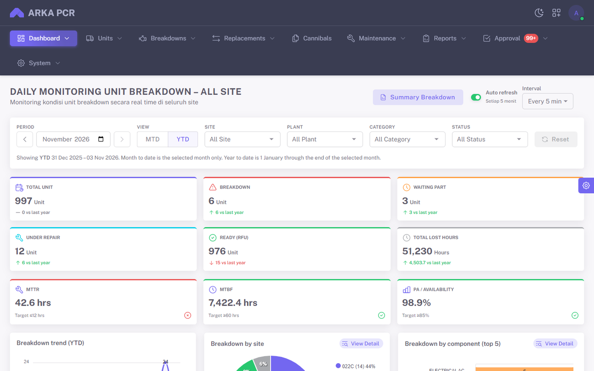

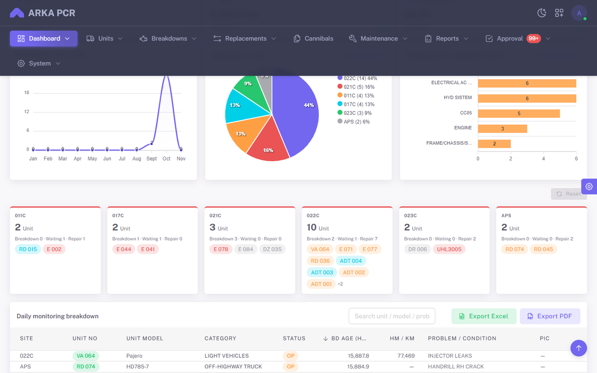

---

## 9. PA Maintenance + Breakdown

Di dashboard **Maintenance Control**, kartu **PA / Availability** mengurangi jam kalender dengan downtime dari:

1. Temuan maintenance (failure), dan  
2. Episode **Breakdown** (BD start → finish; open sampai cut-off),

dengan overlap per unit digabung (tidak dihitung dua kali). Drill-down PA menampilkan sumber Finding dan BD.

---

## 10. Alur kerja singkat

```
Unit down → Add Breakdown (start + problem + activity)
         → (opsional) Create WO SAP
         → Tambah/ubah activity sampai siap RFU
         → Close (resolution + finish)
         → atau Cancel jika episode dibatalkan (open saja, record tetap)
         → atau Delete jika record harus dihapus permanen
```

Audit trail: create / update / close / cancel / delete / activity / import tercatat di **System → Activity Logs** (log name `breakdowns`).

### API untuk aplikasi lain

Aplikasi eksternal bisa membaca DMBD / Breakdown lewat Bearer API token (System → API Tokens), permission `breakdown.read`:

- `GET /api/v1/dmbd/meta/`
- `GET /api/v1/dmbd/kpi/`
- `GET /api/v1/dmbd/breakdowns/`
- `GET /api/v1/dmbd/breakdowns/{id}/`

Dokumentasi: `docs/dmbd-api.md`.

---

## Izin akun

| Izin | Fungsi |
| --- | --- |
| `breakdown.read` | List, detail, report board, dashboard DMBD |
| `breakdown.create` | Add, import history |
| `breakdown.update` | Edit, activity, close, refresh WO, ETA board |
| `breakdown.cancel` | Cancel open breakdown (status CANCEL, record tetap) |
| `breakdown.delete` | Hapus permanen breakdown (+ cleanup SAP bila masih open) |

Setelah permission baru di-sync (`npm run rbac:sync-features`), user perlu **login ulang** agar ACL memuat `breakdown.cancel` / `breakdown.delete`.
