# User Manual — Fundamental Maintenance

Panduan memakai modul **Maintenance** di ARKA PCR. Isinya: program perawatan (**Type**), jadwal (**Plan**), pelaksanaan (**Actual**), temuan (**Failure**), dan dashboard **Maintenance Control**.

| | |
| --- | --- |
| **Dokumen** | User Manual Fundamental Maintenance |
| **Tanggal** | 13 Oktober 2026 |
| **Bahasa** | Bahasa Indonesia. Nama tombol dan kolom di layar tetap bahasa Inggris |
| **Untuk** | Pengguna di site dan pembaca dashboard |

Tombol yang tidak muncul di layar berarti akun Anda tidak punya izin untuk aksi itu. Minta administrator bila Anda perlu izin tersebut.

---

## Daftar Isi

1. [Ringkasan](#1-ringkasan)
2. [Cara membuka menu](#2-cara-membuka-menu)
3. [Type — program perawatan](#3-type--program-perawatan)
4. [Plan — jadwal](#4-plan--jadwal)
5. [Actual — pelaksanaan](#5-actual--pelaksanaan)
6. [Failure — temuan](#6-failure--temuan)
7. [Dashboard](#7-dashboard)
8. [Alur kerja](#8-alur-kerja)

---

## 1. Ringkasan

Modul ini mencatat perawatan rutin unit. Ini bukan penggantian komponen PCR.

| Istilah di layar | Artinya |
| --- | --- |
| **Type / Program** | Jenis perawatan: Greasing, Inspection, PPU/CTS, Track Cleaning, Washing |
| **Plan** | Jadwal satu site, satu tahun, satu bulan, satu program |
| **Plan date** | Satu tanggal yang dijadwalkan untuk satu unit |
| **Actual** | Catatan bahwa perawatan pada plan date itu sudah dikerjakan. Satu plan date hanya punya satu actual |
| **Register no** | Nomor actual, misalnya `PM-022C.2612-0027` |
| **Created By** | Nama user yang membuat actual atau temuan. Terisi otomatis |
| **QC** | Hasil pemeriksaan: Pass, Fail, atau NA |
| **Failure / Finding** | Temuan pada unit. Satu kerusakan tetap satu baris sampai ditutup |
| **Frequency** | Berapa kali temuan yang sama masih tercatat, termasuk catatan pertama |
| **Closed on** | Tanggal temuan selesai. Kosong berarti masih terbuka |

### Yang perlu diingat

- **Plan yang sudah punya actual tidak bisa diubah tanggalnya.** Kotak tanggal itu hijau dan terkunci. Yang tetap bisa dilakukan: **menambah tanggal baru**, dan melepas centang tanggal yang **belum** punya actual.
- **Akun yang hanya punya izin tambah tanggal tidak bisa mengubah plan yang sudah terinput.** Tanggal tersimpan tampil ungu dengan gembok. Akun itu hanya bisa **menambah tanggal baru**. Lihat [Izin akun pada jadwal](#izin-akun-pada-jadwal).
- **Tidak ada tombol hapus satu plan** di daftar. Mengurangi jadwal dilakukan dengan melepas centang, lalu **Save**.
- **Import Excel hanya menambah data.** Baris yang sudah ada tidak diubah dan tidak dihapus.
- **Actual kedua untuk plan date yang sama tidak bisa disimpan.**
- **Temuan dibuat di form Actual**, bukan dari menu Failure. Menu Failure hanya untuk membaca daftar.
- **Temuan yang sudah disimpan tidak punya tombol hapus.** Sebelum **Save**, kartu temuan baru masih bisa dibuang dengan **Remove**.
- **Menghapus actual ikut menghapus semua temuan dan foto di actual itu.** Jendela konfirmasi menampilkan jumlahnya. Untuk pekerjaan yang batal tanpa menghapus catatan, klik **Cancel** di halaman detail actual.

---

## 2. Cara membuka menu

**Type, Plan, Actual, dan Failure** ada di menu **Maintenance**.

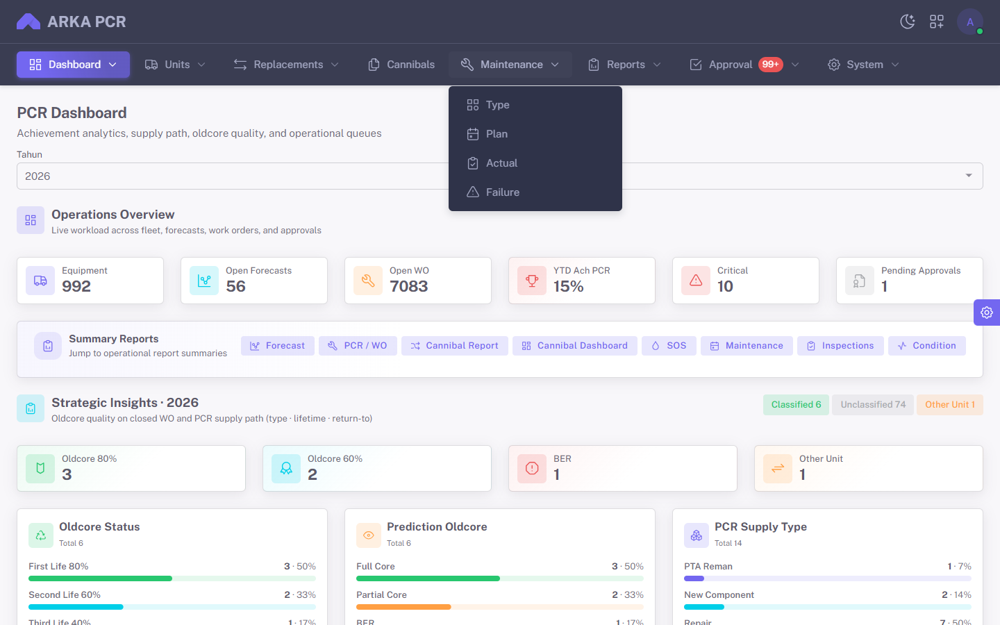

_Gambar 1 — Menu Maintenance: Type, Plan, Actual, Failure._

**Dashboard** ada di menu **Dashboard → Maintenance Control**. Menu ini terpisah dari PCR Dashboard.

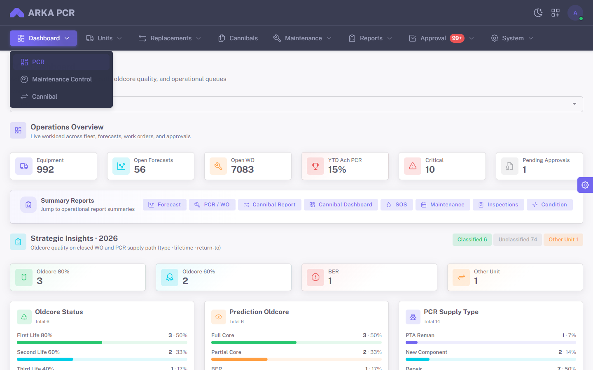

_Gambar 2 — Dashboard → Maintenance Control._

---

## 3. Type — program perawatan

**Untuk apa:** melihat dan mengatur nama program yang dipakai di Plan, Actual, dan Dashboard.

**Menu:** `Maintenance` → `Type`

Tidak ada halaman detail terpisah. Daftar ini sudah menampilkan semua program.

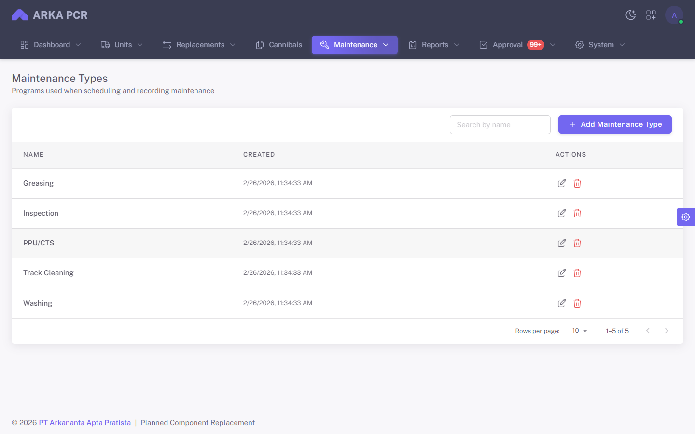

_Gambar 3 — Daftar program. Tiap baris punya ikon pensil (ubah) dan tempat sampah (hapus)._

### Menambah program

1. Klik **Add Maintenance Type**.
2. Isi **Name**. Contoh: Inspection, Greasing.
3. Klik **Save**.

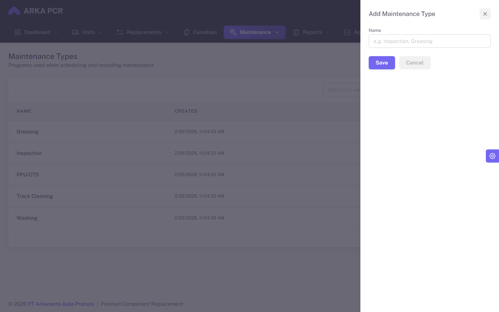

_Gambar 4 — Panel Add Maintenance Type di sisi kanan._

Nama yang disimpan akan muncul di filter Plan, Actual, dan Dashboard.

### Mengubah nama program

1. Klik ikon pensil pada baris.
2. Ubah **Name**.
3. Klik **Save**.

Panelnya sama dengan tambah, judulnya **Edit Maintenance Type**.

### Menghapus program

1. Klik ikon tempat sampah pada baris.
2. Muncul kotak konfirmasi **Delete this maintenance type?**
3. Klik **Delete** untuk menghapus. **Cancel** hanya menutup kotak itu tanpa menghapus.

Program yang sudah dipakai di Plan atau Actual **tidak terhapus**. Pesannya: program itu masih dipakai, hapus pemakaiannya lebih dulu.

---

## 4. Plan — jadwal

**Untuk apa:** menentukan tanggal perawatan tiap unit.

**Menu:** `Maintenance` → `Plan`

Satu baris = **satu site + satu tahun + satu bulan + satu program**. Angka **Total Plan** adalah jumlah tanggal yang dicentang.

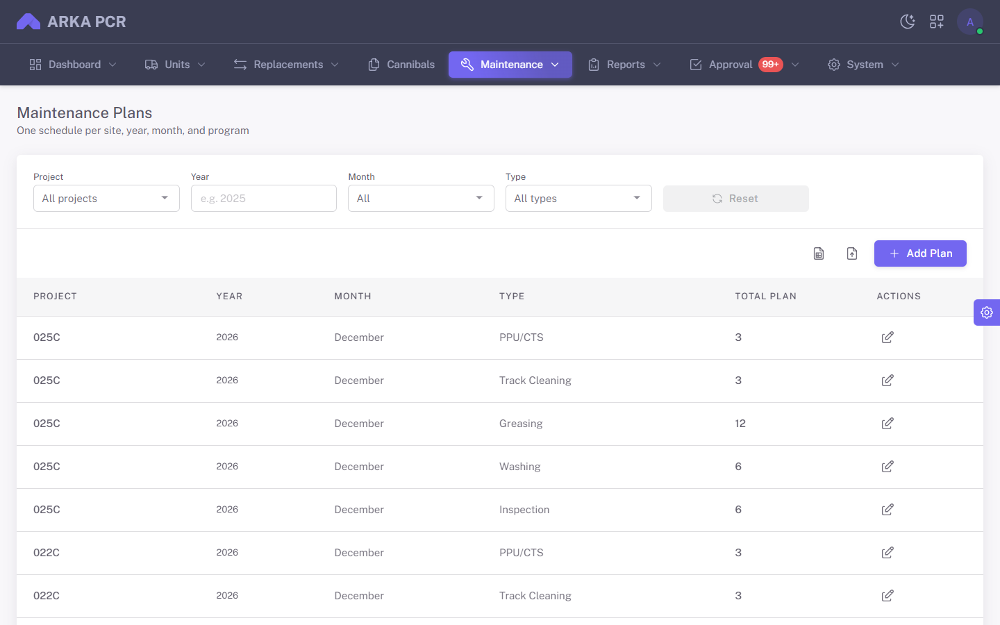

_Gambar 5 — Filter Project, Year, Month, Type. Di kanan: Export, Import, dan Add Plan. Kolom Actions hanya ikon pensil._

Tidak ada halaman detail terpisah, dan **tidak ada tombol hapus plan**. Ikon pensil membuka jadwal lengkap. Dari situ Anda melihat tanggal dan mengubahnya.

### Menambah jadwal

1. Klik **Add Plan**.
2. Pilih **Project**, **Year**, **Month**, dan **Maintenance Type**.
3. Klik **Generate**. Muncul tabel unit (baris) dan tanggal bulan itu (kolom).
4. Centang tanggal pada baris unit.
5. Klik **Save**.

Hanya unit berstatus **ACTIVE** di site itu yang muncul. Kotak **Search unit** menyaring baris unit.

Kalau kombinasi site + tahun + bulan + program itu sudah ada, sistem membuka jadwal yang sudah tersimpan. Anda menambah tanggal di situ, bukan membuat plan kedua.

### Melihat dan mengubah jadwal

1. Di daftar, klik ikon pensil pada baris.
2. Jadwal yang sudah ada langsung terbuka. Tidak perlu klik **Generate** lagi.
3. Centang tanggal baru, atau lepas centang tanggal yang boleh diubah.
4. Klik **Save**.

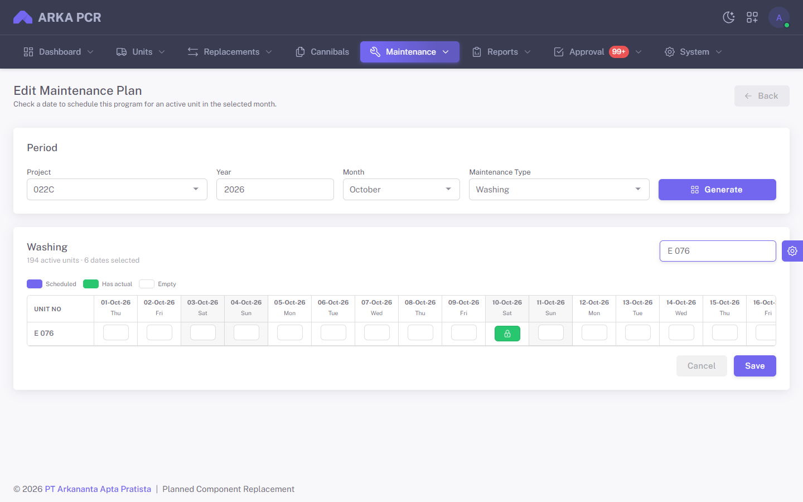

_Gambar 6 — Jadwal Washing satu site. Kotak ungu = terjadwal. Kotak hijau dengan gembok = sudah ada actual, tidak bisa dilepas._

| Warna kotak | Artinya | Bisa diubah? |
| --- | --- | --- |
| Ungu + centang | Terjadwal, belum ada actual | Centang bisa dilepas, lalu **Save** (butuh izin ubah tanggal) |
| Ungu + gembok | Terjadwal, tetapi akun Anda tidak boleh mengubah tanggal yang sudah tersimpan | Tidak. Lihat [Izin akun pada jadwal](#izin-akun-pada-jadwal) |
| Hijau + gembok | Sudah ada actual | Tidak, untuk semua akun. Pesan di layar: tanggal ini sudah punya actual |
| Putih | Belum dijadwalkan | Bisa dicentang sebagai tanggal baru (butuh izin tambah tanggal) |

**Menambah plan tetap bisa** walaupun sebagian tanggal sudah punya actual. Centang tanggal yang masih putih, lalu **Save**.

### Izin akun pada jadwal

Menambah tanggal dan mengubah tanggal yang **sudah tersimpan** adalah dua izin yang berbeda. Akun Anda bisa punya salah satu saja.

| Izin akun | Yang bisa | Yang tidak bisa |
| --- | --- | --- |
| **Tambah tanggal** saja | Mencentang kotak putih (tanggal baru), lalu **Save** | Melepas atau mengubah tanggal yang sudah tersimpan. Kotaknya ungu dengan gembok |
| **Ubah tanggal** saja | Melepas centang tanggal yang sudah tersimpan (belum ada actual), lalu **Save** | Menambah tanggal baru. Klik kotak putih memunculkan pesan bahwa Anda tidak bisa menambah tanggal |
| Keduanya | Menambah dan melepas tanggal | Tanggal yang sudah punya actual (hijau) |
| Tidak keduanya | Hanya melihat jadwal | Tombol **Save** tidak muncul |

Bila akun Anda hanya boleh menambah tanggal, di atas grid muncul catatan:

> _Existing dates stay as they are. You can add a new date, but you cannot change or remove one that is already scheduled._

Artinya: **plan yang sudah terinput tidak bisa diubah atau dihapus oleh akun Anda. Yang bisa hanya menambah tanggal baru.** Arahkan kursor ke kotak ungu bergembok; tulisannya _You cannot change or remove this date_.

Bila sebuah tanggal salah input dan akun Anda tidak boleh mengubahnya, minta user dengan izin ubah tanggal (misalnya Supervisor / Foreman atau Planner) untuk melepasnya.

Template role bawaan:

| Role | Tambah tanggal | Ubah / lepas tanggal tersimpan |
| --- | --- | --- |
| Planner / Admin, Plant Superintendent | Ya | Ya |
| Supervisor / Foreman | Tidak | Ya |
| Plant Manager, Project Manager | Tidak | Tidak (hanya lihat) |

Administrator bisa mengatur izin per role. Jadi akun Anda bisa berbeda dari tabel ini; yang berlaku adalah yang tampil di layar.

Mengubah **Project, Year, Month, atau Type** pada plan yang sudah tersimpan tidak memindahkan tanggal lama. Itu dianggap jadwal lain. Tanggal lama tetap di plan semula.

### Menghapus tanggal

1. Buka jadwal lewat ikon pensil.
2. Klik kotak **ungu** supaya centangnya hilang.
3. Klik **Save**.

Kotak **hijau** tidak bisa diklik. Selama actual pada tanggal itu masih ada, tanggal plan-nya tetap.

Tidak ada cara menghapus satu baris plan dari daftar. Kalau semua tanggal yang belum punya actual dilepas, tanggal yang terkunci tetap tersimpan.

### Export dan import

- **Export** mengunduh jadwal sesuai filter yang sedang dipakai. Satu baris Excel = satu tanggal untuk satu unit.
- Kolom file: **Project, Year, Month, Unit, Plan Date, Maintenance Type**. Bulan tertulis lengkap, misalnya `October`.
- **Import** membuka jendela **Ketentuan Import Maintenance Plan** lebih dulu. Baca alurnya, lalu klik **Pilih File** dan pilih file `.xlsx`. **Batal** menutup jendela tanpa mengimpor.

Yang wajib diisi di Excel: **Unit**, **Plan Date**, **Maintenance Type**. **Project** boleh diisi, dan harus sama dengan site unit itu. **Year** dan **Month** tidak perlu diisi; sistem mengambilnya dari Plan Date.

Import **hanya menambah** tanggal yang belum ada. Tanggal yang sudah terjadwal tidak diubah dan tidak dihapus. Karena itu, melepas tanggal tetap dilakukan di grid, bukan lewat Excel.

---

## 5. Actual — pelaksanaan

**Untuk apa:** mencatat bahwa satu plan date sudah dikerjakan.

**Menu:** `Maintenance` → `Actual`

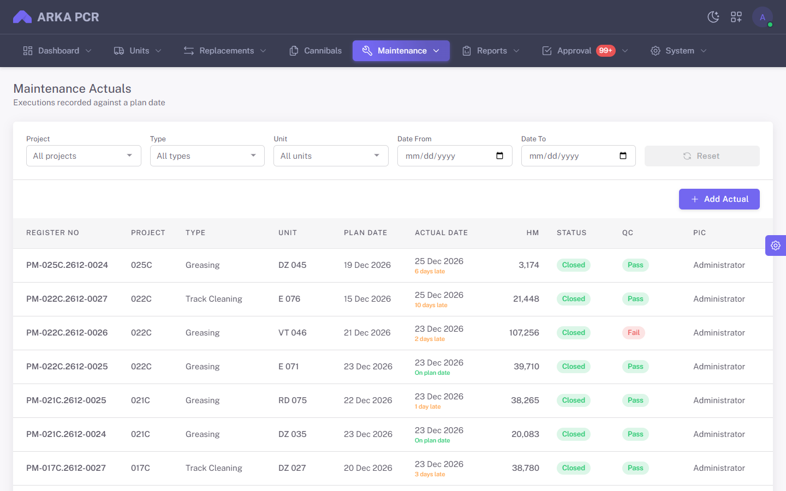

_Gambar 7 — Daftar actual: Register No, plan date, tanggal pelaksanaan, HM, Status, QC. Kolom Action: mata (lihat), pensil (ubah), tempat sampah (hapus)._

Filter: **Project**, **Type**, **Unit**, **Date From**, **Date To**. Rentang tanggal ini memakai tanggal pelaksanaan.

Di daftar masih ada kolom **PIC**. Isinya sama dengan **Created By** di form: orang yang tercatat saat actual dibuat.

### Menambah actual

1. Klik **Add Actual**.
2. Di kartu kiri, pilih **Project** lebih dulu.
3. Pilih **Unit** bila ingin satu unit saja. Daftar unit hanya unit project itu. **All units** menampilkan semua unit project.
4. Pilih **Year**, **Month**, dan **Maintenance Type** bila perlu.
5. Klik **Search Plan**.
6. Pilih **satu** plan date. Tanggal tertulis seperti `01 Dec 2026`. Plan date yang sudah punya actual bertanda **Recorded** dan tidak bisa dipilih.
7. Di kartu kanan, isi:
   - **Maintenance Date** — tanggal pengerjaan. Boleh beda dari plan date.
   - **Hour Meter**, **Time**, **Mechanics**, **Remarks** — boleh kosong.
   - **QC status** — Pass, Fail, atau NA.
   - **Status** — **Closed** bila sudah dikerjakan, **Cancelled** bila pekerjaan dibatalkan. Actual Cancelled tidak dihitung sebagai terlaksana di PM Compliance.
   - **Photos** — bila ada.
8. **Created By** sudah terisi nama Anda. Tidak bisa diganti.
9. **Register no** terisi sendiri saat disimpan.
10. Klik **Save**.

Satu plan date hanya boleh satu actual. Kalau tanggal yang Anda cari tidak muncul, cek dulu: tanggal itu sudah dicentang di Plan, atau actual-nya memang sudah ada.

Selisih tanggal pelaksanaan dan plan date yang membuat daftar menampilkan **On plan date** atau **N days late**.

### Melihat detail

Klik ikon mata pada baris.

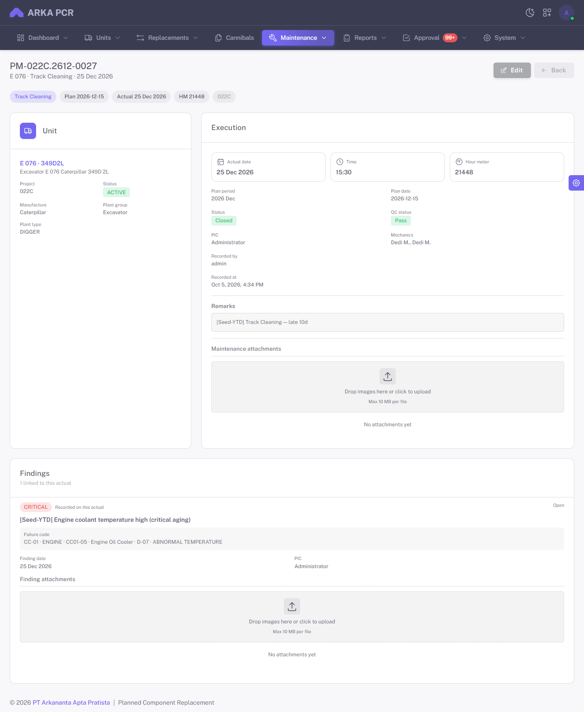

_Gambar 8 — Halaman detail: data unit, pelaksanaan, dan temuan di bawahnya. Di kanan atas: Edit dan Back. Di aplikasi sekarang juga ada tombol **Cancel** atau **Closed** di sebelah kiri Edit._

Yang terlihat:

- Kartu unit: site dan status unit.
- Kartu pelaksanaan: tanggal, jam, HM, periode plan, status, QC, PIC, dan mekanik.
- **Findings**: temuan yang tercatat pada actual ini.

Dari halaman ini Anda bisa klik **Edit**. Menghapus actual dilakukan dari daftar, bukan dari halaman detail. Foto di halaman detail bisa dihapus bila akun Anda punya izin kelola lampiran.

### Membatalkan atau menutup actual

Di kanan atas halaman detail ada tombol status. Tombol ini hanya muncul bila akun Anda boleh mengubah actual.

| Status sekarang | Tombol yang muncul | Hasilnya |
| --- | --- | --- |
| Closed | **Cancel** | Status menjadi **Cancelled** |
| Cancelled | **Closed** | Status kembali **Closed** |

1. Klik **Cancel** atau **Closed**.
2. Jendela konfirmasi menulis Register no, unit, dan akibatnya.
3. Klik **Cancel Actual** atau **Set Closed** untuk menyimpan, atau **Back** untuk batal.

Actual yang **Cancelled** tetap ada, lengkap dengan temuan dan fotonya. Bedanya, actual itu **tidak dihitung sebagai terlaksana** di PM Compliance. Plan date-nya tetap terkunci, jadi tidak bisa dibuat actual kedua untuk tanggal itu. Status juga bisa diubah lewat **Edit**.

### Mengubah actual

Klik ikon pensil di daftar, atau **Edit** di halaman detail.

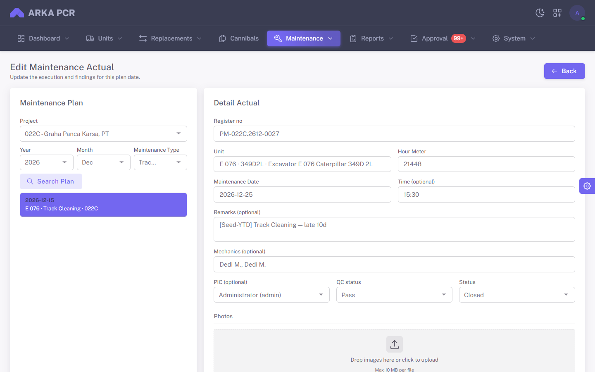

_Gambar 9 — Form ubah actual. Kartu kiri adalah plan date. Kartu kanan adalah pelaksanaan. Di aplikasi sekarang, kolom PIC pada gambar ini sudah menjadi **Created By** (terisi otomatis), kartu kiri punya filter **Unit**, dan tanggal plan tertulis seperti `15 Dec 2026`._

Yang bisa diubah: tanggal pelaksanaan, HM, jam, mekanik, QC, status, catatan, foto, dan isi temuan.

Yang tidak berubah: **Register no**, **Created By**, dan plan date yang sudah terpilih. Jangan membuat actual baru untuk plan date yang sama.

Klik **Save** setelah selesai.

### Menghapus actual

1. Di daftar, klik ikon tempat sampah pada baris.
2. Muncul jendela **Delete maintenance actual?** Jendela ini menulis Register no dan unit, lalu apa saja yang ikut terhapus:
   - actual itu sendiri,
   - jumlah **temuan** yang tercatat pada actual ini,
   - jumlah **foto**: foto actual dan foto temuan.
3. Baca jumlahnya. Klik **Delete** untuk menghapus semuanya, atau **Cancel** untuk menutup jendela tanpa menghapus apa pun.

**Penghapusan tidak bisa dibatalkan.** Temuan dan foto yang ikut terhapus tidak bisa dikembalikan.

Setelah terhapus:

- Plan date itu bisa dicatat actual lagi. Kotak hijaunya di grid Plan kembali bisa diatur.
- Semua temuan yang tercatat pada actual ini hilang dari daftar Failure dan dari dashboard.
- Temuan dari actual **sebelumnya** tetap ada. Hanya catatan tindak lanjutnya di actual yang dihapus yang hilang, jadi **Frequency** temuan itu bisa turun.

Bila pekerjaannya memang batal tetapi catatannya ingin disimpan, jangan dihapus. Klik **Cancel** di halaman detail. Lihat [Membatalkan atau menutup actual](#membatalkan-atau-menutup-actual).

### Import actual dan temuan

**Import** di daftar Actual membuka jendela **Ketentuan Import Maintenance Actual** lebih dulu. Baru setelah itu klik **Pilih File**.

Urutan yang aman:

1. Buat plan dan centang tanggalnya.
2. **Export** dari daftar Actual. Baris plan yang belum punya actual ikut terunduh, **Register No**-nya kosong.
3. Isi hanya baris yang sudah dikerjakan.
4. Import file itu.

Baris yang tidak diisi dilewati.

| Kolom | Aturan |
| --- | --- |
| Unit, Plan Date, Maintenance Type | Wajib. Ini yang mencocokkan ke plan |
| Maintenance Date | Wajib untuk actual baru |
| Register No | Kosong = nomor dibuat otomatis |
| Hour Meter, jam, mekanik, QC, remarks | Boleh kosong |
| Severity, Finding, Component, Sub Component, Damage | Wajib bila ada kolom temuan yang diisi |
| Finding Date | Kosong = sama dengan tanggal pelaksanaan |
| Closed On | Boleh kosong (temuan masih terbuka) |
| Kolom nama dan Created By | Tidak dibaca. Created By = user yang mengimpor |

Actual dan temuan yang **sudah ada tidak diubah** oleh import.

---

## 6. Failure — temuan

Temuan **tidak** dibuat, diubah, atau dihapus dari menu Failure. Semua itu dilakukan di form Actual. Menu Failure hanya daftar untuk dibaca.

### Mencatat temuan baru

1. Buka **Add Actual** atau **Edit** pada actual yang sedang dikerjakan.
2. Gulir ke kartu **Failures**.
3. Klik **Add Finding**.
4. Isi kartu, lalu **Save** di bawah form.

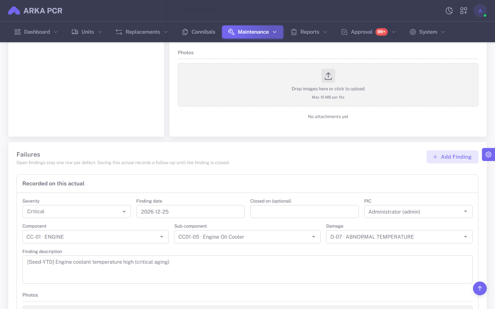

_Gambar 10 — Kartu temuan di form actual. Di aplikasi sekarang, PIC pada gambar ini sudah menjadi **Created By** dan terisi otomatis._

| Field | Isi |
| --- | --- |
| **Severity** | Critical, Major, atau Minor |
| **Finding date** | Tanggal temuan ditemukan |
| **Closed on** | Kosongkan jika masih terbuka. Isi tanggal bila sudah selesai |
| **Created By** | Terisi otomatis dengan user yang login. Tidak bisa dipilih |
| **Component / Sub component / Damage** | Kode dari SAP. Sub component mengikuti component yang dipilih |
| **Finding description** | Uraian temuan |
| **Photos** | Foto temuan, bila ada |

Kartu yang **belum** di-save punya tombol **Remove**. Klik itu untuk membuang kartu sebelum disimpan.

Satu kerusakan tetap **satu baris**. Saat actual berikutnya pada unit yang sama disimpan, temuan yang masih terbuka tidak dibuat ulang. Sistem mencatat tindak lanjut, dan **Frequency** naik. Mengisi **Closed on** menghentikan kenaikan itu.

Di form actual berikutnya, temuan terbuka dari actual lama muncul lagi. Anda bisa mencentang **Progressed** dan mengisi **Closed on**.

### Mengubah temuan

1. Buka **Edit** pada actual tempat temuan itu tercatat.
2. Ubah kartu bertuliskan **Recorded on this actual**.
3. Klik **Save**.

**Created By** temuan lama tetap nama pembuatnya. Tidak diganti dengan user yang sedang mengedit.

Tidak ada form ubah di halaman daftar Failure.

### Menghapus temuan

Satu temuan yang **sudah disimpan tidak punya tombol hapus**.

Yang bisa dilakukan:

- Buang kartu baru dengan **Remove**, selama belum **Save**.
- Tutup temuan dengan mengisi **Closed on**.
- Hapus fotonya dari kartu, bila akun Anda boleh menghapus lampiran.

Menghapus **actual** ikut menghapus **semua temuan** yang tercatat di actual itu, beserta fotonya. Lihat bagian [Menghapus actual](#menghapus-actual).

### Membaca daftar temuan

**Menu:** `Maintenance` → `Failure`

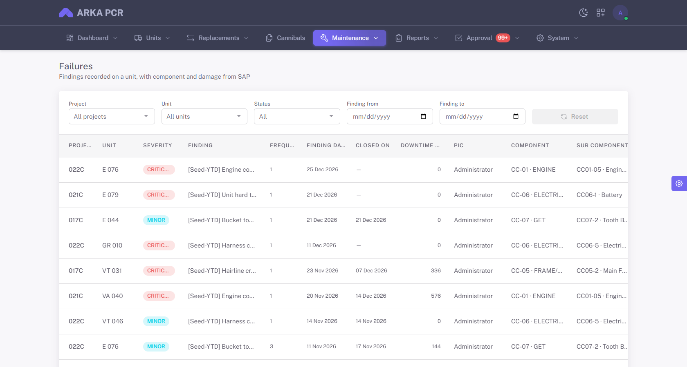

_Gambar 11 — Filter Project, Unit, Status, dan rentang finding date. Geser tabel ke kanan untuk kolom Damage. Halaman ini tidak punya tombol Export atau Import._

| Kolom | Artinya |
| --- | --- |
| **Severity** | Critical (merah), Major, Minor (biru) |
| **Frequency** | Berapa kali temuan ini masih muncul, termasuk catatan pertama |
| **Finding date** | Tanggal temuan |
| **Closed on** | Tanggal tutup. Tanda strip = masih terbuka |
| **Downtime Hours** | Jam dari finding date sampai tanggal tutup, atau sampai hari ini bila masih terbuka |
| **PIC** | Orang yang tercatat saat temuan dibuat (Created By) |
| **Component / Sub component / Damage** | Kode SAP yang disimpan saat input |

Ikon mata membuka actual tempat temuan itu tercatat.

Filter **Status = Open** menampilkan temuan yang belum ditutup.

Excel temuan ada di **Import / Export daftar Actual**, bukan di halaman ini.

---

## 7. Dashboard

**Untuk apa:** melihat hasil perawatan satu site pada periode yang dipilih.

**Menu:** `Dashboard` → `Maintenance Control`

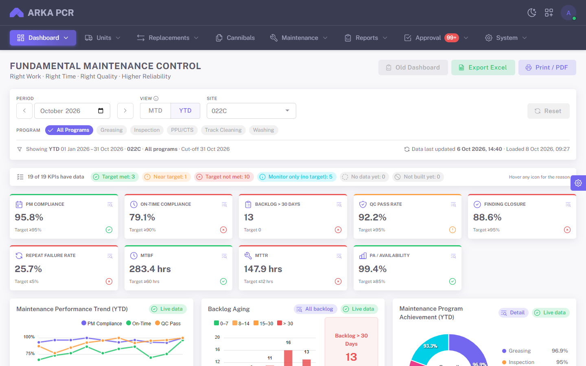

_Gambar 12 — Filter periode, site, dan program. Kartu KPI di atas, grafik di bawah._

### Filter

| Filter | Fungsi |
| --- | --- |
| **Period** | Bulan acuan. Panah kiri/kanan pindah bulan |
| **MTD** | Hanya bulan yang dipilih |
| **YTD** | 1 Januari sampai akhir bulan yang dipilih |
| **Site** | Satu project, atau semua site yang boleh Anda lihat |
| **Program** | Semua program, atau satu type |

Tulisan di bawah filter menunjukkan rentang tanggal yang dihitung, misalnya `YTD 01 Jan 2026 – 31 Oct 2026`. **Reset** mengembalikan filter bawaan.

Warna kartu dibanding target: hijau = tercapai, oranye = mendekati, merah = belum. Arahkan kursor ke ikon info untuk penjelasan angkanya.

| Kartu | Artinya |
| --- | --- |
| **PM Compliance** | Actual dibanding plan date yang sudah jatuh tempo |
| **On-Time Compliance** | Actual yang tanggalnya tidak lewat dari plan date |
| **Backlog > 30 Days** | Plan date yang belum punya actual lebih dari 30 hari |
| **QC Pass Rate** | Actual ber-QC Pass dibanding yang sudah di-QC |
| **Finding Closure** | Temuan yang sudah ditutup |
| **Repeat Failure Rate** | Temuan dengan frequency lebih dari 1 |
| **MTBF** | Jam operasi antar failure |
| **MTTR** | Rata-rata jam dari finding date sampai tanggal tutup |
| **PA / Availability** | Ketersediaan unit setelah downtime temuan |

### Grafik dan tabel

Gulir ke bawah untuk tren, umur backlog, donut program, tabel KPI, 10 isu terbanyak, dan rincian per program.

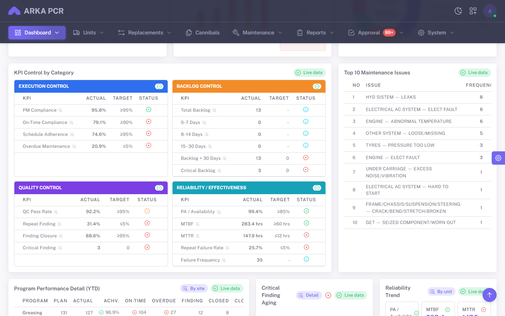

_Gambar 13 — Execution, Backlog, Quality, Reliability, dan Top 10 Maintenance Issues._

Label **Live data** berarti angka itu dihitung dari Plan, Actual, dan Failure. Klik nama program di donut atau di tabel untuk menyaring dashboard ke program itu. Klik lagi untuk kembali ke semua program.

### Melihat baris di balik angka

Klik kartu KPI, atau satu baris di tabel KPI. Jendela menampilkan plan date, actual, atau temuan yang membentuk angka itu.

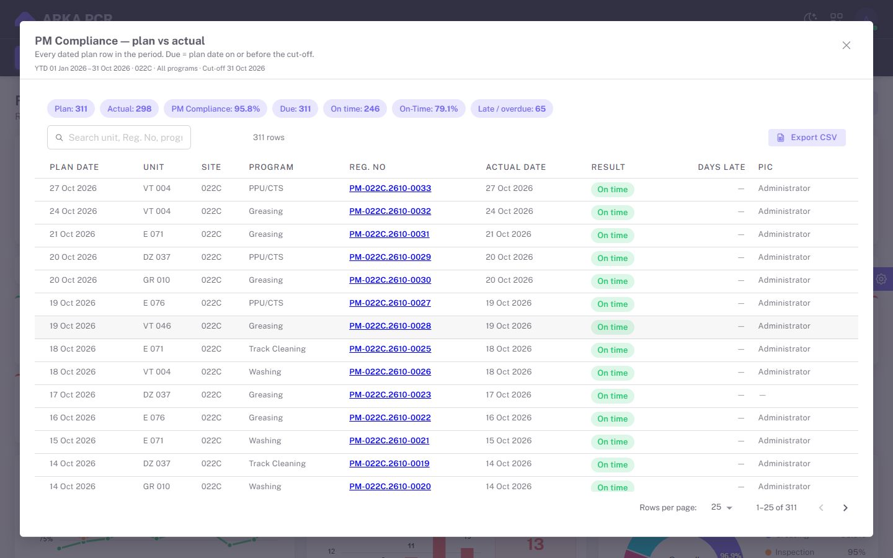

_Gambar 14 — PM Compliance: tiap plan date, register no, hasil On time atau late, dan PIC._

**Reg. No** membuka halaman actual di tab baru. **Export CSV** mengunduh daftar di jendela itu.

**Export Excel** dan **Print / PDF** di kanan atas mengunduh atau mencetak dashboard sesuai filter yang sedang aktif. **Old Dashboard** membuka tampilan achievement lama. Tombol **Back** di sana kembali ke Maintenance Control.

Dashboard hanya membaca data. Mengubah plan, actual, atau temuan tetap dilakukan di menu Maintenance.

---

## 8. Alur kerja

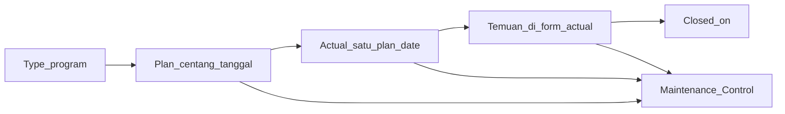

1. Pastikan **Type** yang dipakai site sudah ada.
2. Buat **Plan**: pilih site, tahun, bulan, dan program, lalu **Generate**, centang tanggal, **Save**.
3. Pada hari pengerjaan, **Add Actual** pada plan date itu. Isi tanggal pelaksanaan, HM, mekanik, QC, dan status. **Created By** terisi sendiri.
4. Bila ada kerusakan, **Add Finding** di form yang sama. Tutup temuan dengan **Closed on** setelah selesai.
5. Baca hasilnya di **Maintenance Control**. Klik kartu untuk melihat unit mana yang telat, gagal QC, atau temuannya masih terbuka.

### Jika sesuatu tidak bisa dilakukan

| Yang terjadi | Artinya |
| --- | --- |
| Menu Maintenance atau Dashboard tidak ada | Akun belum punya izin. Minta administrator |
| Tombol Add, Edit, Delete, Export, atau Import tidak ada | Sama: izin akun. Bukan error |
| Generate tidak memunculkan unit | Unit di site itu bukan ACTIVE, atau project-nya salah |
| Plan date tidak muncul saat Search Plan | Belum dicentang di Plan, atau actual untuk tanggal itu sudah ada |
| Kotak hijau tidak bisa dilepas | Actual untuk tanggal itu masih tersimpan. Tambah tanggal lain, atau hapus actual-nya lebih dulu bila memang salah catat |
| Kotak ungu bergembok tidak bisa dilepas | Akun Anda hanya boleh menambah tanggal. Minta user dengan izin ubah tanggal |
| Klik kotak putih muncul pesan tidak bisa menambah tanggal | Akun Anda hanya boleh mengubah tanggal yang sudah ada (misalnya Foreman). Minta Planner menambah tanggal |
| Tidak menemukan tombol hapus plan | Memang tidak ada. Lepas centang tanggal ungu, lalu Save |
| Import tidak mengubah data lama | Memang begitu. Import hanya menambah |
| Program tidak bisa dihapus | Masih dipakai di Plan atau Actual |
| Temuan tidak bisa dihapus | Temuan yang sudah Save tidak punya tombol hapus. Tutup dengan Closed on |
| Kode component atau damage kosong | Koneksi SAP di server. Hubungi administrator |
| Angka dashboard kosong | Ubah Period, Site, atau Program. Pastikan ada plan dan actual di rentang itu |

---

_© ARKA PCR — User Manual Fundamental Maintenance._
